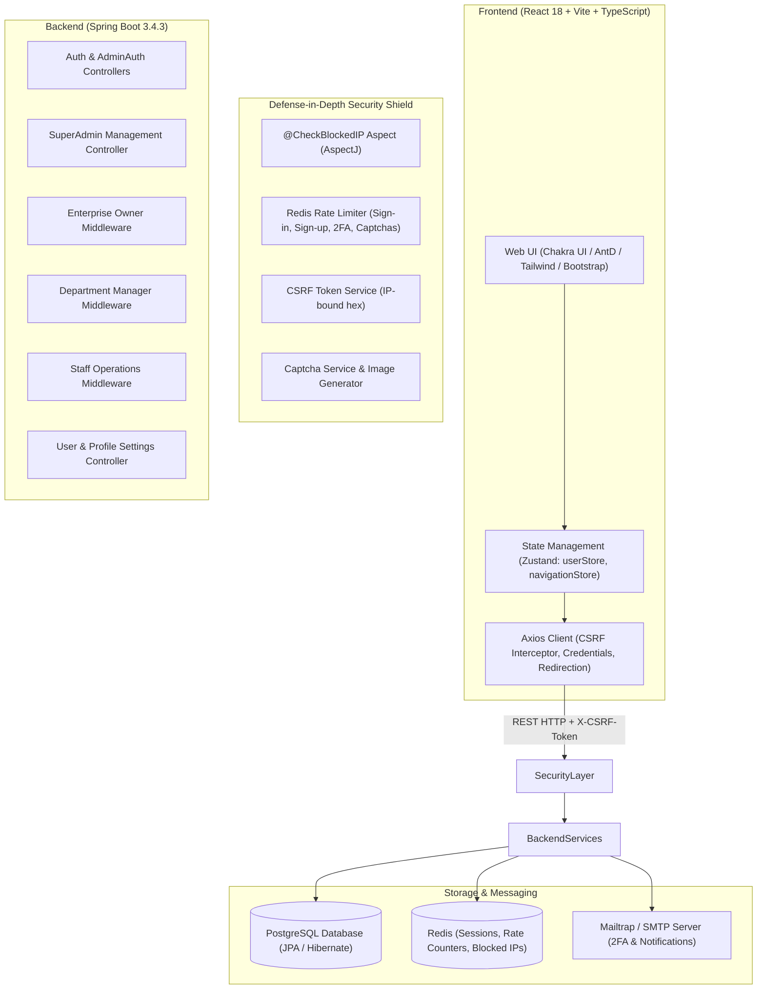

# WorkFlow & Enterprise Management SaaS Platform (PFE)

[](https://spring.io/projects/spring-boot)
[](https://openjdk.org/)
[](https://reactjs.org/)
[](https://www.typescriptlang.org/)
[](https://www.postgresql.org/)
[](https://redis.io/)
[](https://vitejs.dev/)

---

## 📖 Executive Summary

The **WorkFlow & Enterprise Management SaaS Platform** is a distributed, multi-tenant enterprise resource and workflow orchestration system. Designed for scalable organizations, it empowers enterprise owners to model company hierarchies into departments, assign managers with granular capabilities, delegate multi-step production pipelines to departmental staff, and monitor operational performance via real-time reports and analytics.

The platform includes an end-to-end subscription lifecycle (Free, Pro, Enterprise tiers) with manual bank-transfer proof upload and administrator review workflows. To safeguard critical operations, the backend incorporates defense-in-depth security: aspect-oriented IP blocking, Redis-backed rate limiting, custom image-based Captchas, session-tied CSRF token validation, BCrypt password hashing, and email-driven Two-Factor Authentication (2FA).

---

## 🏗️ Architecture & High-Level System Design



---

## 👥 Role-Based Access Control (RBAC) Hierarchy

The platform provides a 4-tier hierarchical access model:

| Role | Scope | Key Permissions & Responsibilities |
| :--- | :--- | :--- |
| **Super Admin / System Admin** | Platform-Wide | Manage system admins; toggle administrative permissions (`canManageUsers`, `canManageEnterprises`, `canVerifyPayments`); review bank payment proofs; modify enterprise tiers; ban/unban users. |
| **Enterprise Owner** | Enterprise-Level | Create/manage enterprises; structure departments; hire and fire managers; configure manager permissions; view consolidated department analytics; upgrade subscription tiers and submit payment proofs. |
| **Department Manager** | Department-Level | Add/remove department staff; configure staff permissions; author and clone multi-step workflows; set deadlines and quantities; assign step tasks; resolve red flags; log team notes. |
| **Staff Member** | Step / Task-Level | Access assigned step tasks; report % completion; mark steps complete; post task notes; raise blockers and operational red flags. |
| **All Authenticated Users** | Personal Account | Manage profile credentials (first/last name, marital status, avatar); execute email address updates; reset password; toggle 2FA. |

---

## 🚀 Key Modules & Functional Walkthrough

### 1. Multi-Tenant Enterprise & Department Management
- **Enterprise Lifecycle:** Owners can create organizations with customized branding, industry domain, and description.
- **Department Partitioning:** Organizations are divided into specialized departments (e.g., Engineering, Quality Assurance, Logistics, Production).
- **Manager Delegation:** Enterprise owners assign managers per department, granting fine-grained privileges:
  - `canAssignTasks`
  - `canCreateWorkflow`
  - `canDeleteWorkflow`
  - `canEditWorkflow`
  - `canManageStaff`

### 2. Workflow Orchestration & Step Sequencing
- **Workflow Modeling:** Workflows represent complete operational lifecycles (associated with customers, document attachments, start times, and strict deadlines).
- **Sequential Steps (`WorkflowStep`):** Workflows are broken down into sequential steps with dedicated order, quantity quotas, and department ownership.
- **Workflow Cloning:** Existing workflow templates can be cloned to avoid re-entering recurring project pipelines.
- **Task Assignment (`Task`):** Managers allocate steps to departmental staff with defined responsibilities.

### 3. Execution, Issue Tracking & Collaboration
- **Progress Tracking:** Staff members adjust real-time progress percentages and mark steps as complete.
- **Red Flag System (`RedFlag`):** When unexpected blockers, quality issues, or supply chain bottlenecks arise, staff can raise red flags. Managers inspect, address, and mark flags as solved.
- **Team Notes (`Note`):** Contextual discussion boards tied to specific steps, maintaining an audit trail of decisions between managers and team members.

### 4. Subscription & Payment Proof Lifecycle
- **Subscription Tiers (`Subscription`):** Defines organizational quotas:
  - Maximum departments
  - Maximum managers
  - Maximum staff members
  - Maximum active workflows
  - Monthly/Annual fee
- **Proof-of-Payment Verification (`SubscriptionRequest` & `Image`):**
  1. Enterprise Owner selects an upgraded tier (e.g., Pro, Enterprise).
  2. Owner uploads proof of payment (wire transfer receipt image).
  3. System Admins view the pending request queue in `/admin-dashboard/verifypayments`.
  4. Admin reviews payment details and uploaded receipt image.
  5. Upon approval/rejection, the system applies the plan quotas and triggers automated email notification.

### 5. Reporting & PowerBI Analytics
- **Departmental Reports:** Aggregates completed and active workflow steps, deadlines, and issue logs.
- **Executive Summaries:** Enterprise owners can inspect reports across all departments or drill down into individual workflow reviews.
- **Visual Dashboards:** Embedded charts (Chart.js, Recharts) and PowerBI integration for business intelligence metrics.

---

## 🛡️ Security Architecture & Defense-in-Depth

### 1. Redis-Backed Distributed Rate Limiting (`RateLimiterService`)
Protects against brute-force and credential-stuffing attacks:
- **Sign-in:** Maximum 3 attempts per 5 minutes; 15 attempts per hour.
- **Sign-up:** Maximum 1 attempt per 5 minutes; 1 per hour.
- **2FA OTP Confirmation:** Maximum 3 confirmations per 5 minutes.
- **2FA Code Resend:** Strict throttle window per IP.
- **Captcha Requests:** Rate limited; excessive refreshing triggers automatic IP quarantine.

### 2. Aspect-Oriented IP Quarantine (`@CheckBlockedIP`)
- Implemented as an AspectJ aspect (`CheckBlockedIPAspect.java`) intercepting sensitive controllers.
- Translates client IPv4 addresses into standardized hexadecimal strings.
- Checks Redis key `blocked:<hexIP>`. If blocked, immediately aborts execution with HTTP 403 / runtime exception.

### 3. IP-Bound CSRF Token Verification (`CsrfTokenService`)
- On application boot, the client requests a cryptographic CSRF token via `GET /auth/csrf-token`.
- The token is keyed to the client's hashed IP address in Redis with an expiration window.
- The frontend Axios interceptor automatically injects `X-CSRF-Token` on every request.

### 4. Custom Dynamic Captchas (`CapatchaMaker` & `CapatchaService`)
- Server-generated visual verification images rendered on-the-fly.
- Stored transiently in Redis; must be validated before password recovery or upon anomalous request rates.

### 5. Authentication, Two-Factor Authentication (2FA) & Sessions
- Passwords hashed using Spring Security `BCryptPasswordEncoder`.
- Session tokens stored inside HTTP-Only, Secure cookies and synchronized with Redis session hashes (`Session.java`).
- Optional 2FA generates random OTP codes dispatched via Mailtrap SMTP.

---

## 🗄️ Database Schema & Entities

The relational database is built on **PostgreSQL** using **Spring Data JPA / Hibernate**:

```
+-----------------------------------------------------------------------------------+
|                                  DATABASE ENTITIES                                |
+-----------------------------------------------------------------------------------+
|  User                 | Accounts, passwords (BCrypt), 2FA state, roles, avatars   |
|  Admin                | System admin records with granular operational privileges |
|  Enterprise           | Organization profiles, domain, description, subscription  |
|  Subscription         | Plan constraints (max departments, managers, workflows)   |
|  SubscriptionRequest  | Pending plan change requests with timestamps              |
|  Image                | Binary/Base64 payment receipts and proofs of payment      |
|  Department           | Structural organizational units within an enterprise      |
|  Manager              | Department managers with role permission flags            |
|  Staff                | Department staff members with task permission flags       |
|  Workflow             | High-level business pipelines with deadlines and docs     |
|  WorkflowStep         | Ordered stages within a workflow with quantity targets    |
|  Task                 | Assigned work units linked to steps and users             |
|  Note                 | Step-level collaboration logs and discussion threads      |
|  RedFlag              | Step blockers, warnings, and issue resolution status      |
|  Customer             | Clients associated with workflows                         |
|  AuditLog             | System activity logs                                      |
+-----------------------------------------------------------------------------------+
```

---

## 🔌 API Endpoint Catalog

### Authentication & Account (`/auth`)
| Method | Endpoint | Description |
| :--- | :--- | :--- |
| `GET` | `/auth/csrf-token` | Obtains an IP-bound CSRF token and captcha requirement flag |
| `POST` | `/auth/signin` | Authenticates user; checks rate limits, returns session cookie |
| `POST` | `/auth/signup` | Registers new user; dispatches verification email |
| `GET` | `/auth/me` | Fetches active authenticated user profile |
| `GET` | `/auth/logout` | Invalidates cookies and clears Redis session |
| `POST` | `/auth/confirm2faCode` | Verifies 2FA email OTP code |
| `POST` | `/auth/resendTFACode` | Resends 2FA email OTP code |
| `GET` | `/auth/verifyAccount` | Validates registration token from verification email |
| `GET` | `/auth/verifyResetPassword` | Verifies password reset email token |
| `POST` | `/auth/changePassword` | Finalizes password update using valid reset token |

### Admin & SuperAdmin (`/admin` & `/adminAuth`)
| Method | Endpoint | Description |
| :--- | :--- | :--- |
| `POST` | `/adminAuth/signin` | Dedicated portal authentication for system administrators |
| `GET` | `/adminAuth/me` | Fetches authenticated admin identity and permissions |
| `GET` | `/admin/loadAdmins` | Lists all administrative users in the system |
| `POST` | `/admin/saveNewAdmin` | Registers a new system administrator with selected privileges |
| `POST` | `/admin/saveExistingAdmin` | Promotes an existing user to an admin role |
| `POST` | `/admin/changePermission` | Modifies admin permission flags |
| `POST` | `/admin/deleteAdmin` | Revokes administrative access |
| `POST` | `/admin/loadEnterprises` | Searches and filters enterprises |
| `POST` | `/admin/changePlan` | Manually changes the subscription tier of an enterprise |
| `POST` | `/admin/changeEnterpriseOwner` | Reassigns enterprise ownership to another registered user |
| `POST` | `/admin/deleteEnterprise` | Permanently deletes an enterprise and child resources |
| `POST` | `/admin/loadUsers` | Searches and lists platform users |
| `GET` | `/admin/blockUser` | Toggles account ban status |
| `GET` | `/admin/deleteUser` | Deletes user account |
| `GET` | `/admin/loadPayments` | Retrieves pending subscription payment proofs |
| `GET` | `/admin/loadPaymentDetail` | Fetches full details and images for a specific payment proof |
| `GET` | `/admin/paymentResult` | Approves or rejects a subscription payment request |

### Enterprise Owner Middleware (`/middle`)
| Method | Endpoint | Description |
| :--- | :--- | :--- |
| `GET` | `/middle/loaddata` | Loads complete enterprise portfolio, departments, and metrics |
| `GET` | `/middle/refresh` | Refreshes real-time dashboard data |
| `GET` | `/middle/readAll` | Retrieves consolidated reporting records |
| `POST` | `/middle/addEnterprise` | Creates a new enterprise under the caller's account |
| `POST` | `/middle/addDepartment` | Adds a new department to an enterprise |
| `POST` | `/middle/updateDepartment` | Renames department, updates staff rosters |
| `POST` | `/middle/deleteDepartment` | Deletes a department |
| `POST` | `/middle/addManager` | Appoints a department manager with specific permissions |
| `POST` | `/middle/updateManager` | Updates permissions or details of a manager |
| `POST` | `/middle/deleteManager` | Dismisses a department manager |
| `POST` | `/middle/addStaff` | Adds staff member to a department |
| `POST` | `/middle/upload-proof` | Submits payment receipt images for a plan upgrade |

### Manager Middleware (`/managerMiddle`)
| Method | Endpoint | Description |
| :--- | :--- | :--- |
| `POST` | `/managerMiddle/createworkflowmanager` | Creates a workflow with steps, attachments, and deadlines |
| `POST` | `/managerMiddle/updateWorkflow` | Updates workflow steps, ordering, and parameters |
| `POST` | `/managerMiddle/cloneworkflow` | Clones an existing workflow template |
| `POST` | `/managerMiddle/deleteworkflow` | Deletes a workflow and all associated steps |
| `POST` | `/managerMiddle/deleteStep` | Removes a step from an active workflow |
| `POST` | `/managerMiddle/updateDepartmentManager` | Manages staff assignments within the department |
| `POST` | `/managerMiddle/addStaffManager` | Directly recruits staff into the department |
| `POST` | `/managerMiddle/addANote` | Adds a manager note to a specific step |
| `POST` | `/managerMiddle/solveFlag` | Resolves an operational red flag raised by staff |
| `POST` | `/managerMiddle/getManagerAva` | Fetches manager avatar for collaboration views |

### Staff Middleware (`/staffMiddle`)
| Method | Endpoint | Description |
| :--- | :--- | :--- |
| `POST` | `/staffMiddle/updateProgress` | Updates task progress percentage (0 - 100%) |
| `POST` | `/staffMiddle/addNoteStaff` | Adds a collaboration comment to an assigned task |
| `POST` | `/staffMiddle/addFlagStaff` | Raises a blocker / red flag on a task |
| `GET` | `/staffMiddle/markAsComplete` | Sets task status to completed |

### Settings & Captcha (`/settings` & `/capatcha`)
| Method | Endpoint | Description |
| :--- | :--- | :--- |
| `POST` | `/settings/editProfile` | Modifies name, marital status, and profile avatar |
| `POST` | `/settings/changeEmail` | Requests email update with confirmation token |
| `POST` | `/settings/changePassword` | Changes account password (requires old password) |
| `GET` | `/settings/getAvatar` | Streams avatar image binary |
| `POST` | `/capatcha/generate` | Generates a new challenge captcha image |
| `POST` | `/capatcha/solveResetPassword`| Validates captcha prior to dispatching password reset email |

---

## 💻 Frontend Architecture & UI Directory

The user interface is structured cleanly inside `front/src/`:

```
front/src/
├── api/                   # Centralized HTTP Client & Service Layers
│   ├── apiClient.ts       # Axios instance with CSRF bootstrapping & error handlers
│   ├── authService.ts     # User authentication, 2FA, password recovery
│   ├── adminService.ts    # System administration API integration
│   ├── dashboardService.ts# Enterprise, department, workflow data loading
│   ├── settingsService.ts # Profile and security configuration
│   └── capatchaService.ts # Captcha generation and verification calls
├── pages/                 # Route Views & Dashboards
│   ├── login.tsx          # User sign-in with remember-me & rate-limit handling
│   ├── forgotPassword.tsx # Password recovery flow with captcha
│   ├── PasswordReset.tsx  # Reset password landing page (token verification)
│   ├── VerifyAccount.tsx  # Account registration confirmation
│   ├── Blocked.tsx        # Security quarantine alert screen
│   ├── Capatcha.tsx       # Dedicated visual captcha solver
│   ├── DashboardHome.tsx  # Home analytics and overview
│   ├── EnterpriseCardsList.tsx # List of enterprises owned by user
│   ├── ManageEnterprise.tsx   # Enterprise departments and configuration
│   ├── ManageManagers.tsx     # Department manager appointment & permissions
│   ├── ManageStaffs.tsx       # Department staff directory
│   ├── ManageWorkflows.tsx    # Workflow catalog & creation modal
│   ├── ManageWorkflow.tsx     # Visual workflow builder & step manager
│   ├── teamNotes.tsx          # Step collaboration discussion board
│   ├── redflags.tsx           # Issue tracking & blocker resolution
│   ├── AssignedTasksList.tsx  # Staff task overview
│   ├── task.tsx               # Individual task execution screen
│   ├── DepartmentReportCards.tsx # Performance report overview
│   ├── ViewDepartmentReports.tsx # Detailed department reports
│   ├── ViewReport.tsx         # In-depth single workflow review
│   ├── pricingPlans.tsx       # Subscription tier selection
│   ├── UploadPaymentProof.tsx # Receipt image upload for tier upgrades
│   ├── ProfileDashboard.tsx   # User profile navigation wrapper
│   ├── EditProfile.tsx        # User profile editor (avatar, personal details)
│   ├── ProfileSecurity.tsx    # Password update and 2FA toggles
│   ├── AdminLogin.tsx         # System admin login portal
│   ├── AdminDashboard.tsx     # System admin overview & navigation
│   ├── AdminManagement.tsx    # Admin creation & permission management
│   ├── EnterprisesManagement.tsx # System-wide enterprise management
│   ├── ManageUsers.tsx        # System-wide user directory & banning
│   └── PaymentsManagment.tsx  # Subscription payment proof verification
├── router/                # Route Guards
│   ├── AuthRoute.tsx          # Restricts authenticated users from auth pages
│   ├── ProtectedRoute.tsx     # Requires standard user authentication
│   ├── AdminAuthRoute.tsx     # Prevents authenticated admins from re-logging
│   └── ProtectedAdminRoute.tsx# Restricts access to verified system admins
├── store/                 # Global Zustand State Stores
│   ├── userStore.ts       # User identity, enterprise data, task assignments
│   └── navigationStore.ts # UI navigation state
├── types/                 # TypeScript Interfaces & Enums
│   ├── entity.ts          # Core domain models
│   └── enum.ts            # Enums
└── App.tsx                # Master Route Hierarchy
```

---

## 🛠️ Installation & Setup Guide

### Prerequisites
Make sure your development machine has the following tools installed:
1. **Java JDK 17** or higher
2. **Maven 3.8+**
3. **Node.js 18+** and **npm**
4. **PostgreSQL 14+**
5. **Redis Server 6+**

---

### 1. Database Configuration
1. Start your local PostgreSQL server.
2. Create a new database named `pfe`:
```sql
CREATE DATABASE pfe;
```
3. Update connection credentials in `pfe back/src/main/resources/application.properties` if your PostgreSQL username/password differs:
```properties
spring.datasource.url=jdbc:postgresql://localhost:5432/pfe
spring.datasource.username=postgres
spring.datasource.password=root
```

---

### 2. Redis Configuration
1. Ensure your Redis instance is running locally on port `6379`:
```bash
redis-server
```
2. Verify Redis connectivity:
```bash
redis-cli ping
# Expected output: PONG
```

---

### 3. Mail Server Configuration (Mailtrap)
The backend uses Mailtrap for testing email dispatch (account activation, 2FA OTP, and password reset). Update `pfe back/src/main/resources/application.properties`:
```properties
spring.mail.host=sandbox.smtp.mailtrap.io
spring.mail.port=587
spring.mail.username=<YOUR_MAILTRAP_USERNAME>
spring.mail.password=<YOUR_MAILTRAP_PASSWORD>
spring.mail.properties.mail.smtp.auth=true
spring.mail.properties.mail.smtp.starttls.enable=true
```

---

### 4. Running the Backend Server
Navigate to the backend directory and launch the Spring Boot application:

```powershell
cd "pfe back"
mvn clean spring-boot:run
```
*The Spring Boot server will initialize on port **8080** (`http://localhost:8080`).*

---

### 5. Running the Frontend Application
In a separate terminal, navigate to the frontend directory, install dependencies, and launch Vite:

```powershell
cd front
npm install
npm run dev
```
*The React application will be available at **`http://localhost:5173`**.*

---

## ⚙️ Build & Deployment

### Production Frontend Build
```powershell
cd front
npm run build
```
Generates an optimized single-page application bundle inside `front/dist/`.

### Production Backend Package
```powershell
cd "pfe back"
mvn clean package -DskipTests
```
Generates the executable JAR file inside `pfe back/target/demo-0.0.1-SNAPSHOT.jar`. Run with:
```powershell
java -jar target/demo-0.0.1-SNAPSHOT.jar
```

---

## 🔒 Security Best Practices for Production Deployment
- **Rotate Secrets:** Replace default Mailtrap credentials and database passwords with environment variables.
- **SSL / HTTPS:** Enable TLS/SSL certificates (`server.ssl.*` in Spring Boot) so that session cookies operate under `SameSite=Strict; Secure`.
- **CORS Whitelist:** Update `CorsConfig.java` to restrict allowed origins to your production frontend domain.
- **Redis Persistence:** Enable AOF (Append-Only File) or RDB snapshots on Redis to persist rate limiter counters and active sessions across restarts.
