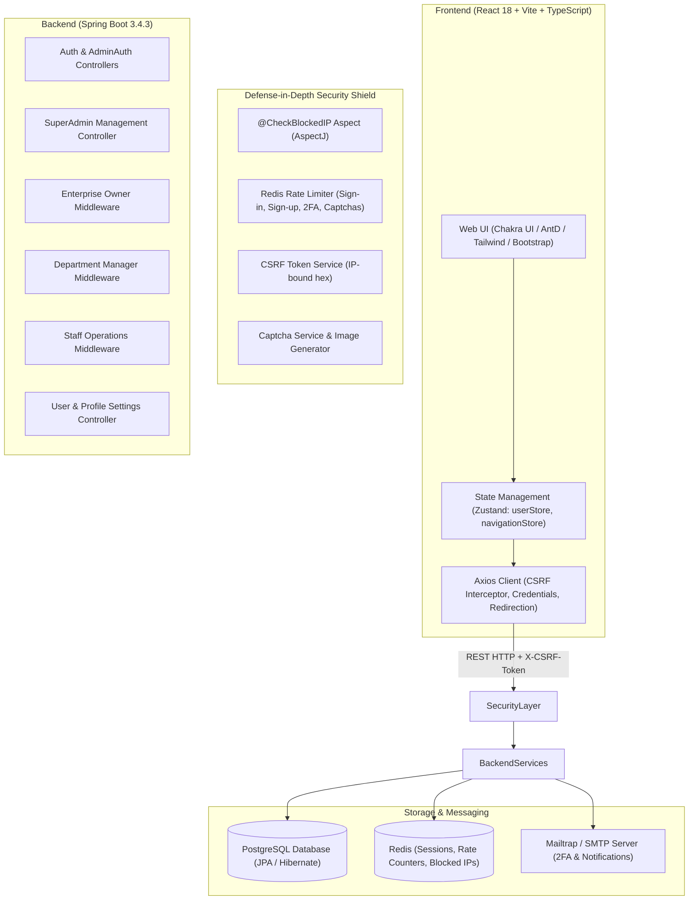

# WorkFlow & Enterprise Management SaaS Platform (PFE)

---

## 📖 Executive Summary

The **WorkFlow & Enterprise Management SaaS Platform** is a distributed, multi-tenant enterprise resource and workflow orchestration system. Designed for scalable organizations, it empowers enterprise owners to model company hierarchies into departments, assign managers with granular capabilities, delegate multi-step production pipelines to departmental staff, and monitor operational performance via real-time reports and analytics.

The platform includes an end-to-end subscription lifecycle (Free, Pro, Enterprise tiers) with manual bank-transfer proof upload and administrator review workflows. To safeguard critical operations, the backend incorporates defense-in-depth security: aspect-oriented IP blocking, Redis-backed rate limiting, custom image-based Captchas, session-tied CSRF token validation, BCrypt password hashing, and email-driven Two-Factor Authentication (2FA).

---

## 🏗️ Architecture & High-Level System Design

---

## 👥 Role-Based Access Control (RBAC) Hierarchy

The platform provides a 4-tier hierarchical access model:

| Role | Scope | Key Permissions & Responsibilities |
| :--- | :--- | :--- |
| **Super Admin / System Admin** | Platform-Wide | Manage system admins; toggle administrative permissions (`canManageUsers`, `canManageEnterprises`, `canVerifyPayments`); review bank payment proofs; modify enterprise tiers; ban/unban users. |
| **Enterprise Owner** | Enterprise-Level | Create/manage enterprises; structure departments; hire and fire managers; configure manager permissions; view consolidated department analytics; upgrade subscription tiers and submit payment proofs. |
| **Department Manager** | Department-Level | Add/remove department staff; configure staff permissions; author and clone multi-step workflows; set deadlines and quantities; assign step tasks; resolve red flags; log team notes. |
| **Staff Member** | Step / Task-Level | Access assigned step tasks; report % completion; mark steps complete; post task notes; raise blockers and operational red flags. |
| **All Authenticated Users** | Personal Account | Manage profile credentials (first/last name, marital status, avatar); execute email address updates; reset password; toggle 2FA. |

---

## 🚀 Key Modules & Functional Walkthrough

### 1. Multi-Tenant Enterprise & Department Management
- **Enterprise Lifecycle:** Owners can create organizations with customized branding, industry domain, and description.
- **Department Partitioning:** Organizations are divided into specialized departments (e.g., Engineering, Quality Assurance, Logistics, Production).
- **Manager Delegation:** Enterprise owners assign managers per department, granting fine-grained privileges:
  - `canAssignTasks`
  - `canCreateWorkflow`
  - `canDeleteWorkflow`
  - `canEditWorkflow`
  - `canManageStaff`

### 2. Workflow Orchestration & Step Sequencing
- **Workflow Modeling:** Workflows represent complete operational lifecycles (associated with customers, document attachments, start times, and strict deadlines).
- **Sequential Steps (`WorkflowStep`):** Workflows are broken down into sequential steps with dedicated order, quantity quotas, and department ownership.
- **Workflow Cloning:** Existing workflow templates can be cloned to avoid re-entering recurring project pipelines.
- **Task Assignment (`Task`):** Managers allocate steps to departmental staff with defined responsibilities.

### 3. Execution, Issue Tracking & Collaboration
- **Progress Tracking:** Staff members adjust real-time progress percentages and mark steps as complete.
- **Red Flag System (`RedFlag`):** When unexpected blockers, quality issues, or supply chain bottlenecks arise, staff can raise red flags. Managers inspect, address, and mark flags as solved.
- **Team Notes (`Note`):** Contextual discussion boards tied to specific steps, maintaining an audit trail of decisions between managers and team members.

### 4. Subscription & Payment Proof Lifecycle
- **Subscription Tiers (`Subscription`):** Defines organizational quotas:
  - Maximum departments
  - Maximum managers
  - Maximum staff members
  - Maximum active workflows
  - Monthly/Annual fee
- **Proof-of-Payment Verification (`SubscriptionRequest` & `Image`):**
  1. Enterprise Owner selects an upgraded tier (e.g., Pro, Enterprise).
  2. Owner uploads proof of payment (wire transfer receipt image).
  3. System Admins view the pending request queue in `/admin-dashboard/verifypayments`.
  4. Admin reviews payment details and uploaded receipt image.
  5. Upon approval/rejection, the system applies the plan quotas and triggers automated email notification.

### 5. Reporting & PowerBI Analytics
- **Departmental Reports:** Aggregates completed and active workflow steps, deadlines, and issue logs.
- **Executive Summaries:** Enterprise owners can inspect reports across all departments or drill down into individual workflow reviews.
- **Visual Dashboards:** Embedded charts (Chart.js, Recharts) and PowerBI integration for business intelligence metrics.

---

## 🛡️ Security Architecture & Defense-in-Depth

### 1. Redis-Backed Distributed Rate Limiting (`RateLimiterService`)
Protects against brute-force and credential-stuffing attacks:
- **Sign-in:** Maximum 3 attempts per 5 minutes; 15 attempts per hour.
- **Sign-up:** Maximum 1 attempt per 5 minutes; 1 per hour.
- **2FA OTP Confirmation:** Maximum 3 confirmations per 5 minutes.
- **2FA Code Resend:** Strict throttle window per IP.
- **Captcha Requests:** Rate limited; excessive refreshing triggers automatic IP quarantine.

### 2. Aspect-Oriented IP Quarantine (`@CheckBlockedIP`)
- Implemented as an AspectJ aspect (`CheckBlockedIPAspect.java`) intercepting sensitive controllers.
- Translates client IPv4 addresses into standardized hexadecimal strings.
- Checks Redis key `blocked:<hexIP>`. If blocked, immediately aborts execution with HTTP 403 / runtime exception.

### 3. IP-Bound CSRF Token Verification (`CsrfTokenService`)
- On application boot, the client requests a cryptographic CSRF token via `GET /auth/csrf-token`.
- The token is keyed to the client's hashed IP address in Redis with an expiration window.
- The frontend Axios interceptor automatically injects `X-CSRF-Token` on every request.

### 4. Custom Dynamic Captchas (`CapatchaMaker` & `CapatchaService`)
- Server-generated visual verification images rendered on-the-fly.
- Stored transiently in Redis; must be validated before password recovery or upon anomalous request rates.

### 5. Authentication, Two-Factor Authentication (2FA) & Sessions
- Passwords hashed using Spring Security `BCryptPasswordEncoder`.
- Session tokens stored inside HTTP-Only, Secure cookies and synchronized with Redis session hashes (`Session.java`).
- Optional 2FA generates random OTP codes dispatched via Mailtrap SMTP.
